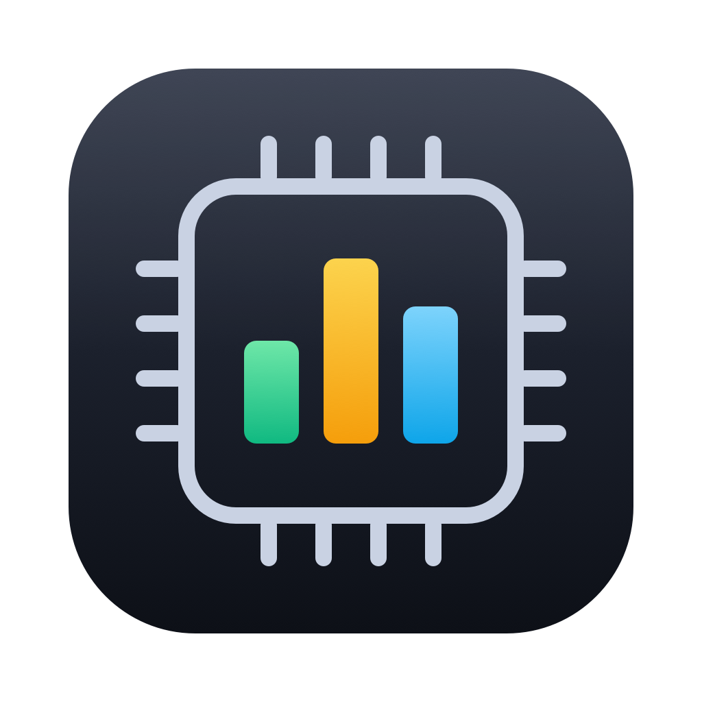

# MacGlance

A light menu bar monitor for Apple Silicon Macs: CPU, GPU, RAM, watts, disk, network and temperatures at a glance, in Bulgarian or English.



## What it shows

- **Menu bar:** CPU, GPU, RAM, watts, and optionally network, free disk space and CPU temperature, in compact two-line blocks.
- **CPU / GPU:** load per core (P and E), real core speeds, which apps use the most, history up to 7 days.
- **RAM:** pressure, the apps holding the most memory, a "Free up RAM" button and automatic cleanup.
- **Energy:** watts per app (measured by macOS), electricity used per day and what it costs.
- **Disk:** free space, read/write speed, SSD health from the drive itself (wear, data written).
- **Network:** speed, latency, Wi-Fi signal, today's traffic (with a heads-up on an iPhone hotspot).
- **Temperatures and thermal throttling, battery health** with tips, **smart notifications**, global shortcuts.

It stays light: about 12 MB of memory and ~0.2% CPU with only the menu bar; sensors you hide aren't read at all.

## Install

Download the latest `MacGlance-x.y.zip` from [Releases](https://github.com/itsnotsimple/macglance/releases), unzip it and move `MacGlance.app` to Applications. After that it updates itself (Settings → Updates).

The app isn't notarized by Apple, so the first time macOS may refuse to open it: right-click → Open, or System Settings → Privacy & Security → Open Anyway.

## Build

Needs macOS 14+ and the Xcode Command Line Tools (full Xcode isn't required).

```sh
./scripts/build-app.sh --install   # builds build/MacGlance.app and copies it to /Applications
```
