<p align="center">
  
</p>

<h1 align="center">MacGlance</h1>

<p align="center">
  A light menu bar monitor for Apple Silicon Macs.<br>
  CPU, GPU, RAM, watts, disk, network, temperatures and battery at a glance, in English or Bulgarian.
</p>

<p align="center">
  <a href="https://github.com/itsnotsimple/macglance/releases/latest"></a>
  
  
  <a href="LICENSE"></a>
</p>

<p align="center">
  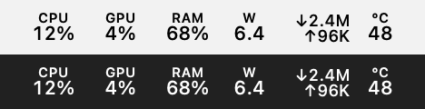
</p>

<p align="center">
  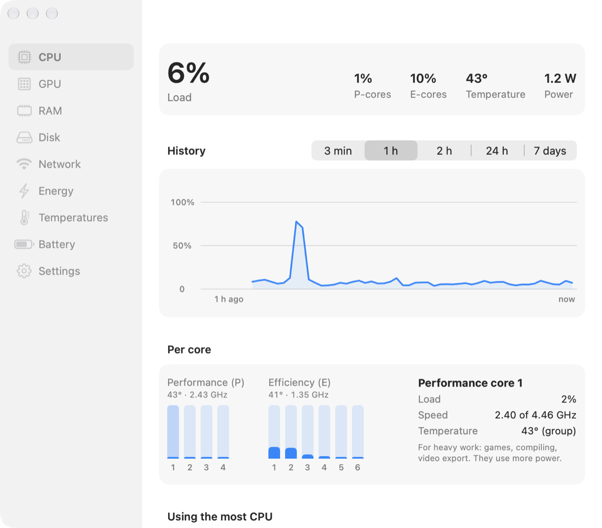
</p>

## What it shows

**In the menu bar:** CPU, GPU, RAM and watts in compact two-line blocks that never shift around; network speed, free disk space and CPU temperature if you want them. Click for a menu with every number, the apps using the most energy, and a "Free up RAM" button.

**In its window:**

<table>
  <tr>
    <td width="50%">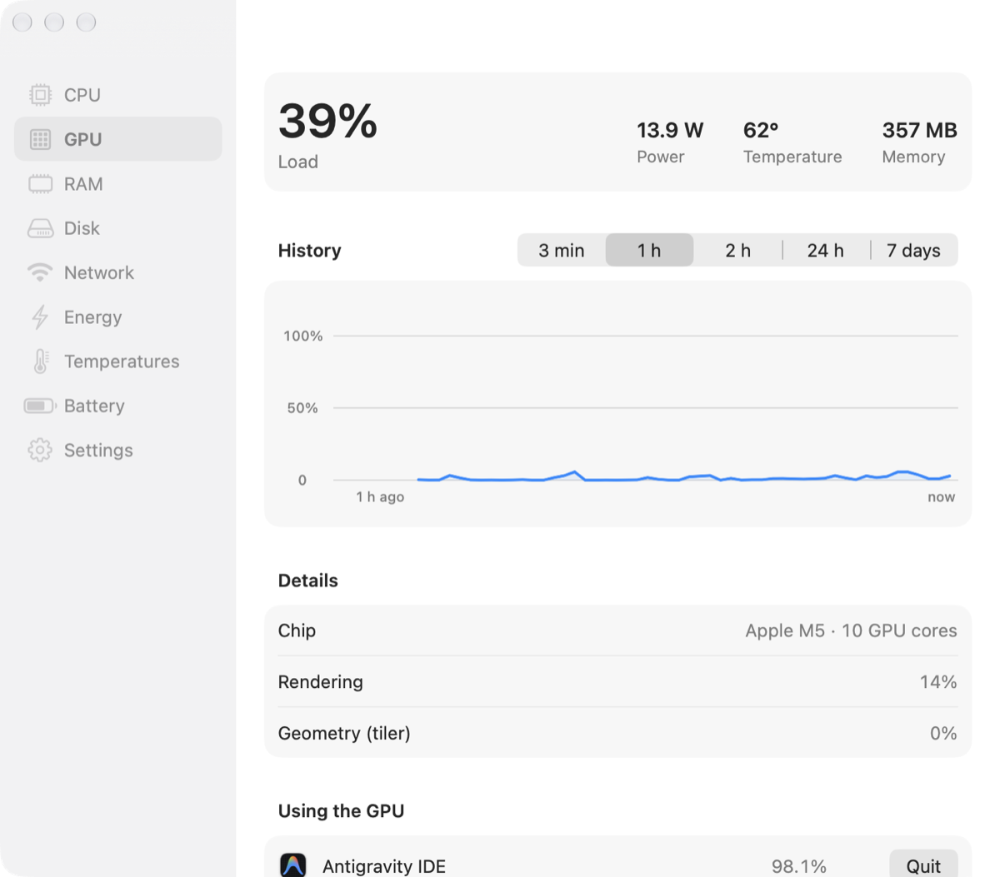<br><b>GPU</b>: load, watts, temperature, memory, which apps use it</td>
    <td width="50%">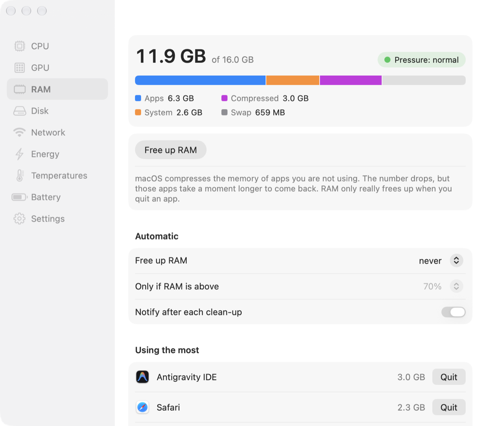<br><b>RAM</b>: memory pressure, the apps holding the most, free up RAM by hand or automatically</td>
  </tr>
  <tr>
    <td>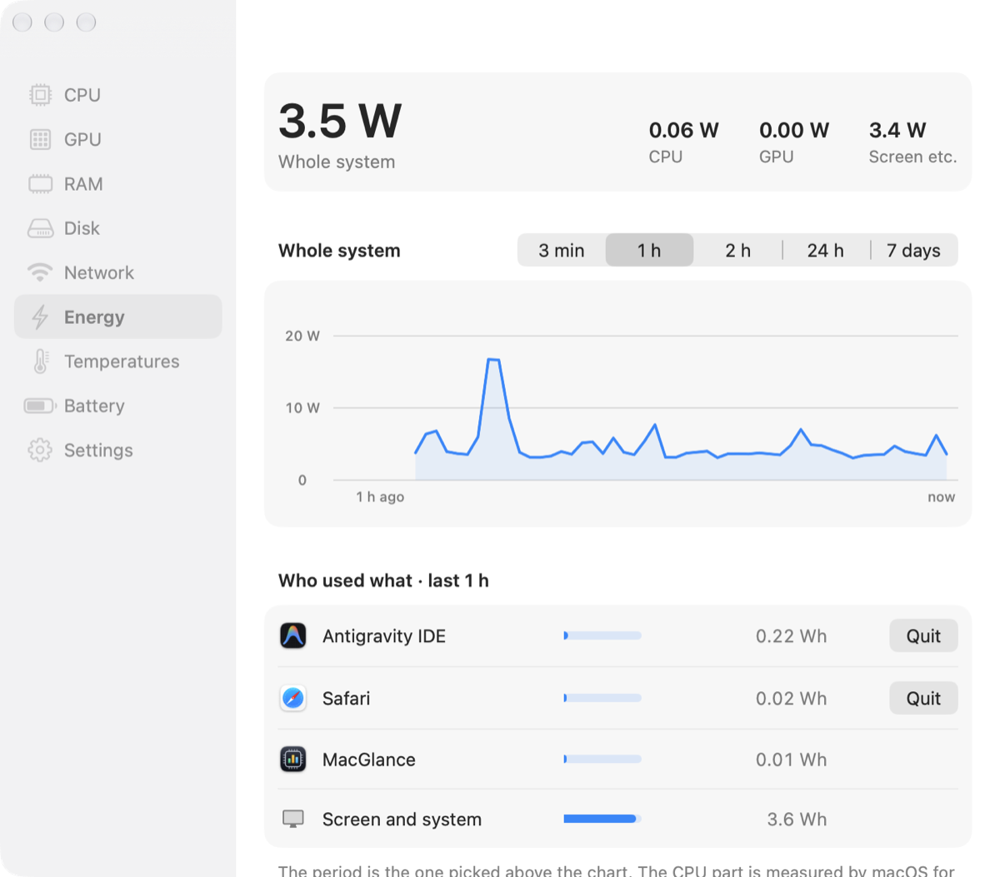<br><b>Energy</b>: watts per app as measured by macOS, energy per day and what it costs</td>
    <td>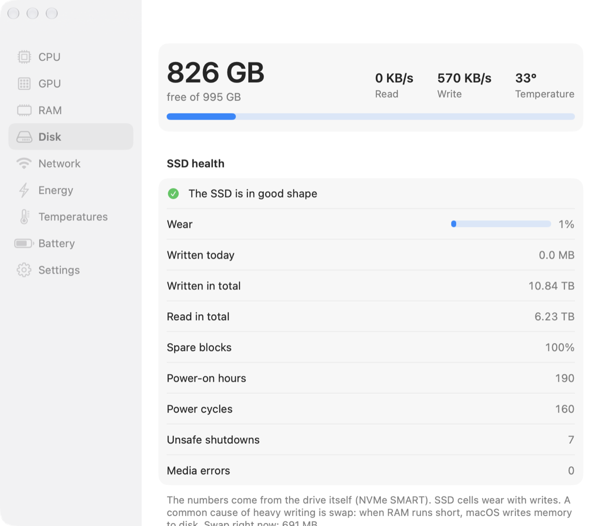<br><b>Disk</b>: free space, read/write speed, clearing app caches, SSD health straight from the drive, and which apps write the most to it</td>
  </tr>
  <tr>
    <td>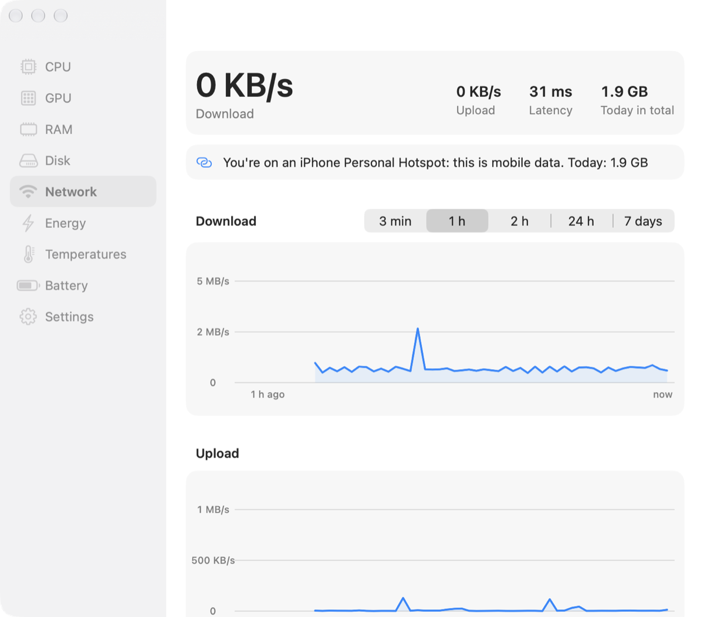<br><b>Network</b>: speed, latency, Wi-Fi signal, data per app today and how much of it on an iPhone hotspot</td>
    <td>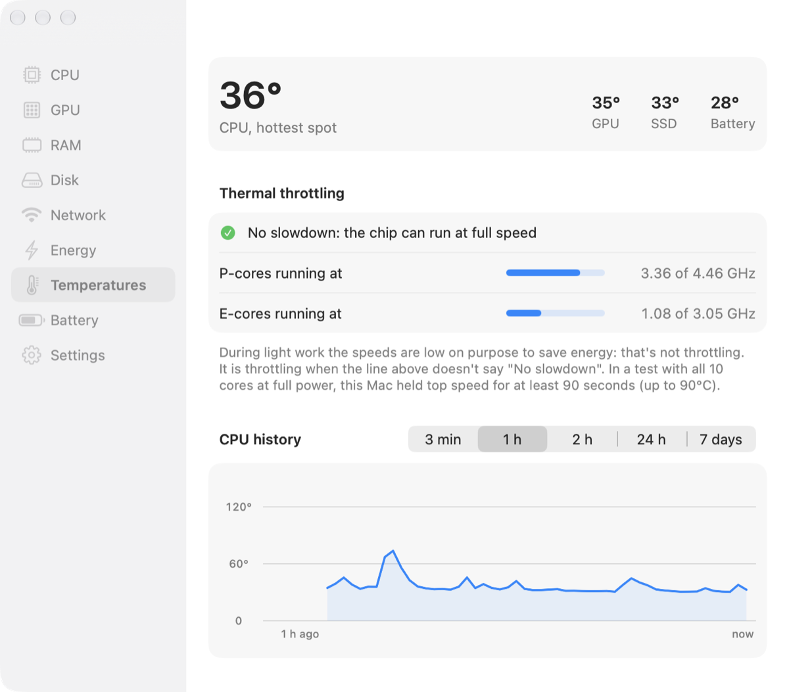<br><b>Temperatures</b>: CPU, GPU, SSD and battery, plus whether macOS is slowing the chip down because of heat</td>
  </tr>
  <tr>
    <td>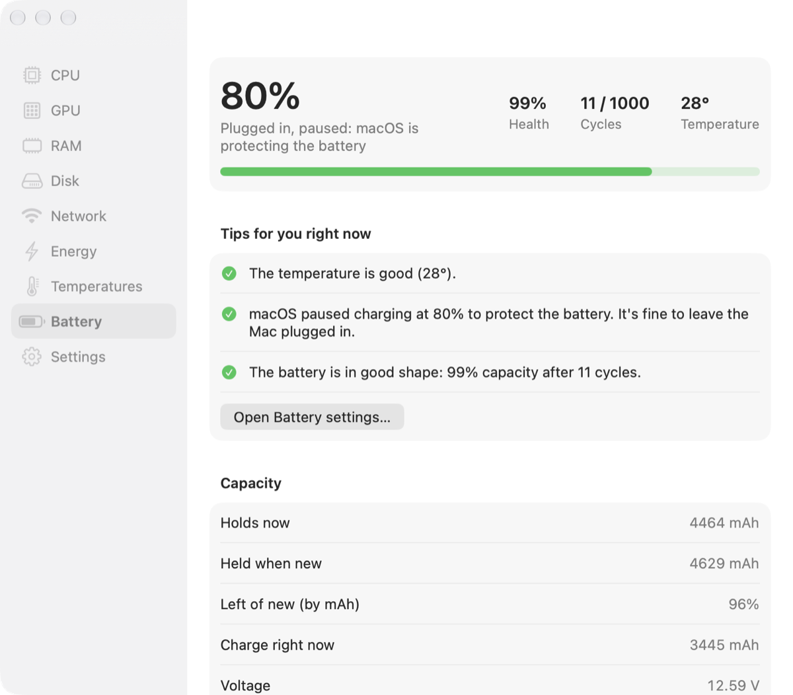<br><b>Battery</b>: health, cycles, capacity, charger, tips, and what woke the Mac while it slept (with what you can switch off)</td>
    <td>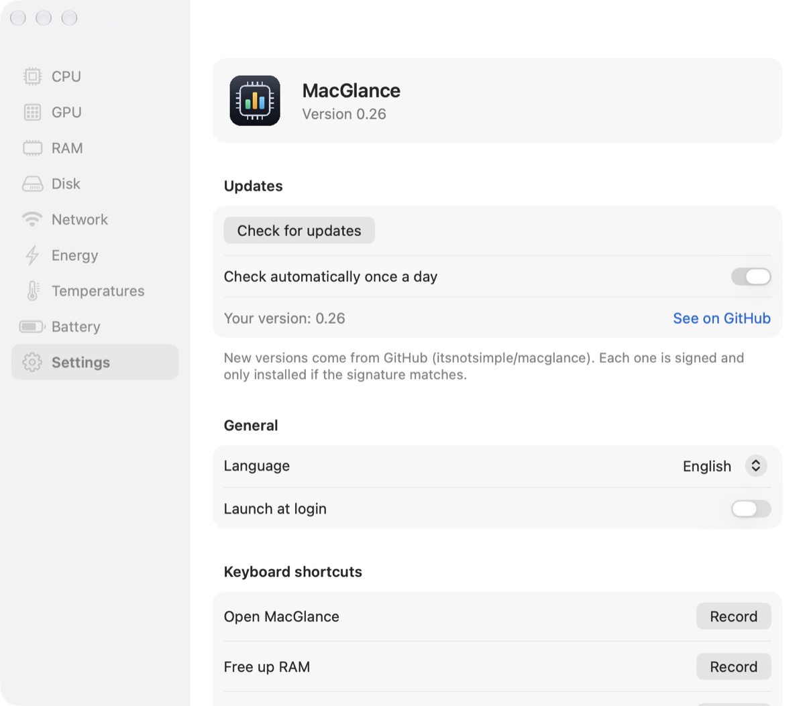<br><b>Settings</b>: language, what goes in the menu bar, notifications, global shortcuts, updates</td>
  </tr>
</table>

**Widgets:** real macOS widgets for the desktop and Notification Center: an overview of everything (medium or large) plus CPU, GPU, RAM, power, network, temperature and battery (small or medium). Right-click the desktop → **Edit Widgets** → search for MacGlance. Like every widget, macOS refreshes them every few minutes; the menu bar is the live view.

<p align="center">
  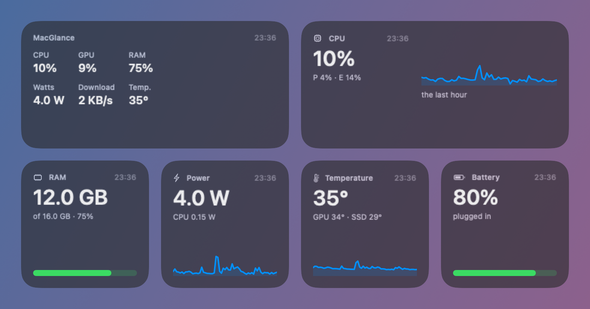
</p>

Charts go back 3 minutes, 1 or 2 hours, 24 hours or 7 days, and their history survives restarts. Optional notifications tell you when an app is stuck at 100% CPU, memory runs short, the charger can't keep up, the battery gets hot, or the chip is slowed down by heat.

## Install

1. Download `MacGlance-x.y.dmg` from [Releases](https://github.com/itsnotsimple/macglance/releases/latest).
2. Open it and drag MacGlance onto Applications.
3. MacGlance is a free project and isn't notarized by Apple, so the first time macOS may say it "is damaged" or "can't be checked". Open Terminal and run:

   ```sh
   xattr -cr /Applications/MacGlance.app
   ```

   That clears the "downloaded from the internet" flag your browser put on it. Or open System Settings → Privacy & Security and click **Open Anyway**.

After that it updates itself (Settings → Updates). Every update is signed, and MacGlance only installs one whose signature matches.

**Needs** macOS 14 Sonoma or later on an Apple Silicon Mac. It's built and tested on a MacBook Air M5; other Apple Silicon Macs should work, though a few sensors may read differently, and anything a Mac doesn't report is simply left out.

## Light by design

- Native Swift, no Electron. The only helper is macOS's own `nettop`, which counts data per app and uses next to no CPU (a watchdog stops it if that ever changes).
- Numbers you hide from the menu bar aren't read at all. Counting SSD writes per app is a 5 ms check once a minute. Scanning every process and reading the detailed sensors happen only while their page or the menu is open; app icons are drawn once and kept.
- Measured on an M5 MacBook Air: with only the menu bar, about 0.5% of one core (0.05% of the whole 10-core chip) and under 20 MB of memory. With the window open on the busiest page (CPU), about 1%.

## Privacy

No account, no analytics. MacGlance only goes online to check GitHub for updates (once a day, can be turned off), and, while the Network page is open, to ask Cloudflare's 1.1.1.1 for your latency and public IP. All history stays on your Mac, in `~/Library/Application Support/MacGlance`.

## How it measures

| What | Where it comes from |
|---|---|
| CPU and GPU load | the kernel's per-core tick counters; the GPU driver's own statistics |
| Watts | the SMC's power rails (matched to CPU, GPU and the whole system by load tests) |
| Watts per app | the energy macOS records for every process, plus each app's share of GPU time |
| Temperatures | SMC and HID sensors |
| Thermal throttling, real core speeds | macOS's thermal pressure level and IOReport's time at each speed step |
| SSD health | the drive's NVMe SMART log |
| SSD writes per app | the bytes the kernel counts for every process; the rest is the SMART total minus the apps |
| Data per app | macOS's `nettop` |
| Sleep and wake-ups | macOS's power log (`pmset -g log`) |

## Build from source

Needs the Xcode Command Line Tools (full Xcode isn't required).

```sh
./scripts/build-app.sh --install   # builds build/MacGlance.app and copies it to /Applications
```

## На български

MacGlance е лек монитор за лентата горе на Mac с Apple Silicon: процесор, видеокарта, RAM, ватове, диск, мрежа, температури и батерия, плюс уиджети за десктопа (десен бутон на десктопа → Edit Widgets → MacGlance). Свали `.dmg` файла от [Releases](https://github.com/itsnotsimple/macglance/releases/latest), отвори го и плъзни MacGlance в Applications. Първия път, ако macOS каже, че е „повреден“: в Terminal пусни `xattr -cr /Applications/MacGlance.app`. След това се обновява сам. Езикът се сменя от Настройки → Език.

## License

[MIT](LICENSE)
